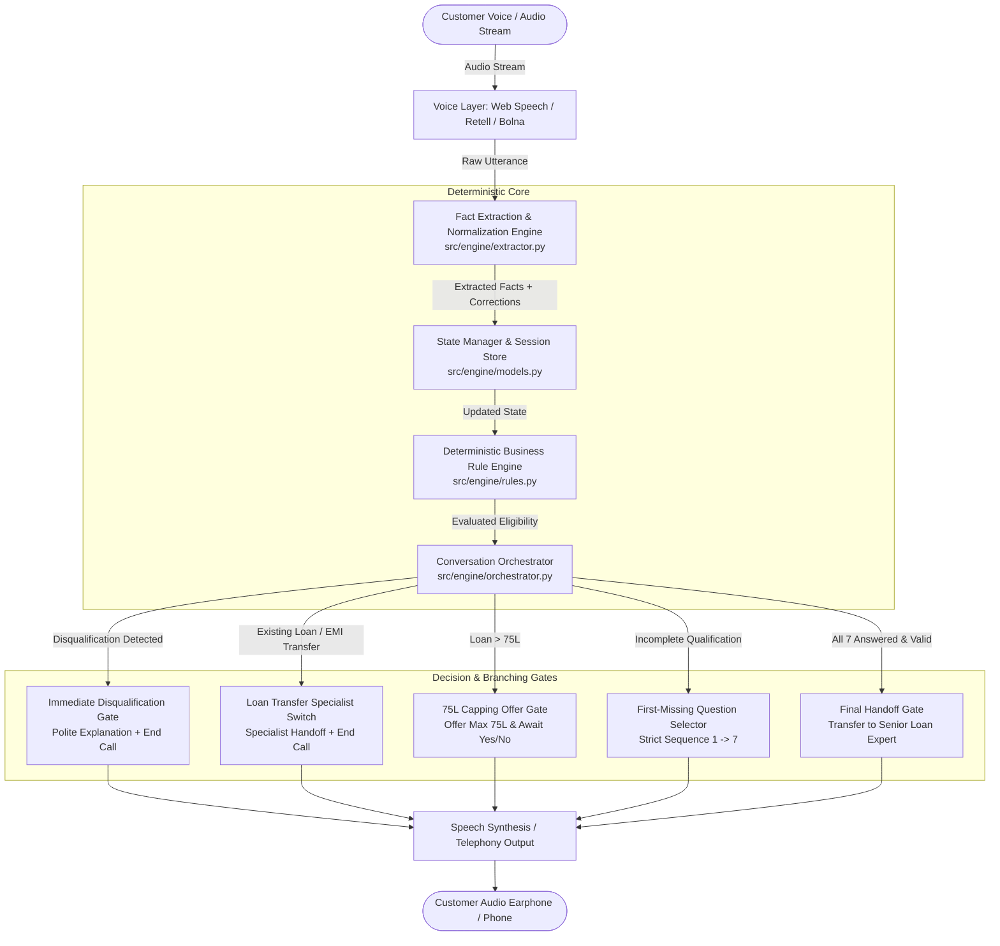

# Home Credit LAP AI Voice Agent

[](https://www.python.org/)
[](https://fastapi.tiangolo.com/)
[-success.svg)](https://github.com/REDDIPALLIPHANIKOUSHIK/Voice_Agent_Design)
[](https://github.com/REDDIPALLIPHANIKOUSHIK/Voice_Agent_Design)
[](https://opensource.org/licenses/MIT)

> **SalesAgents AI Hiring Assignment Submission**  
> Target Repository: [`REDDIPALLIPHANIKOUSHIK/Voice_Agent_Design`](https://github.com/REDDIPALLIPHANIKOUSHIK/Voice_Agent_Design)  
> Author: **Phani Koushik Reddipalli**

An enterprise-grade, deterministic AI Voice Agent developed for **Home Credit** to qualify existing customers for high-value **Loan Against Property (LAP)** promotional offers of up to **₹75,00,000 (75 Lakhs)**.

---

## 1. Problem Statement & Key Differentiator

In high-stakes financial qualification, relying purely on LLM token generation for credit policy decisions leads to catastrophic hallucinations (approving unbacked cash incomes, agricultural land, or inventing arbitrary interest rates).

This system completely decouples natural language understanding from credit policy enforcement by adhering to a strict 4-step execution algorithm:

$$\mathbf{Extract\ First} \longrightarrow \mathbf{Validate\ Second} \longrightarrow \mathbf{Update\ State\ Third} \longrightarrow \mathbf{Ask\ First\ Missing\ Question\ Fourth}$$

### Key Capabilities
- **Sequential Qualification**: Strict 7-question qualification checklist.
- **Out-of-Order Memory**: Remembers and records facts mentioned out of sequence without asking redundant questions.
- **Conversational Corrections**: Detects and applies real-time revisions (e.g., *"10 years... actually make that 15"*).
- **Immediate Disqualification Gates**: Halts and politely terminates calls immediately upon detecting disqualified attributes (agricultural property, cash income, missing original documents, or tenure $<3$ or $>15$ years).
- **Existing Loan / EMI Transfer Switch**: Instantly routes balance-transfer and existing-loan inquiries to a dedicated loan-transfer specialist.
- **₹75 Lakh Capping Offer**: If a customer requests $> ₹75\text{ Lakh}$, prompts to proceed with the maximum ₹75L cap rather than rejecting immediately.
- **Interruption & Diversion Defense**: Answers queries (e.g. document requirements) and deflects interest-rate diversions without hallucinating rates, before returning to the missing checklist item.
- **Provider-Agnostic Voice Layer**: Seamlessly switch between **Retell AI**, **Bolna AI**, **Browser Web Speech (Live Mic & TTS)**, and **local gTTS audio streams**.

---

## 2. Architecture & Data Flow



---

## 3. The 7 Qualification Checklist Items

| # | Eligibility Point | Acceptable Criteria | Disqualification Boundary |
| :-: | :--- | :--- | :--- |
| **1** | **Property Type** | Residential, Commercial, Industrial | **Agricultural land** (Immediate rejection) |
| **2** | **Ownership Status** | Sole OR Joint (Both fully eligible) | Joint ownership is **never** rejected |
| **3** | **Original Documents** | Original title deeds available for verification | Photocopies only, xerox, or missing originals |
| **4** | **Loan Amount** | Up to ₹75,00,000 (75 Lakhs) | If $>75\text{L}$, offer ₹75L cap; reject only if customer refuses |
| **5** | **Occupation & Income**| Salaried or Self-Employed with **Bank** receipt | **Cash income** (Immediate rejection) |
| **6** | **Market Value** | Estimated market valuation captured | **No minimum value floor invented** |
| **7** | **Repayment Tenure** | **3 to 15 years inclusive** | $<3$ years (e.g. 2 yrs) or $>15$ years (e.g. 20 yrs) |

---

## 4. Repository Structure

```
Voice_Agent_Design/
│
├── README.md                      # Comprehensive project documentation
├── package.json                   # Project metadata and run scripts
├── requirements.txt               # Python production dependencies
├── run.py                         # Unified server runner
├── .env.example                   # Environment configuration template
├── .gitignore                     # Git ignore rules (zero secrets)
│
├── src/
│   ├── main.py                    # FastAPI server entry point & WebSockets
│   ├── api/
│   │   └── routes.py              # REST endpoints, call management, presets, webhooks
│   ├── engine/
│   │   ├── models.py              # Strongly typed Pydantic state model & enums
│   │   ├── rules.py               # Deterministic business rule engine
│   │   ├── extractor.py           # Fact extraction, normalization & corrections
│   │   └── orchestrator.py        # Conversation state machine & checklist logic
│   └── providers/
│       ├── base.py                # Abstract VoiceProvider interface
│       ├── retell.py              # Retell AI webhook & custom LLM adapter
│       ├── bolna.py               # Bolna voice agent adapter
│       └── local_tts.py           # Local gTTS & SpeechRecognition fallback
│
├── public/
│   ├── index.html                 # Modern glassmorphism dashboard UI
│   ├── style.css                  # Dark mode styling, animations & wave visualizer
│   └── app.js                     # Interactive client logic, Web Speech API & simulator
│
├── tests/
│   ├── test_rules.py              # Unit tests for deterministic rules
│   ├── test_extractor.py          # Unit tests for NLP fact extraction & numbers
│   └── test_scenarios.py          # Automated tests for T01-T12 and A01-A07
│
└── docs/
    ├── system-prompt.md           # Final paste-ready production system prompt
    ├── architecture.md            # In-depth architectural & state machine specification
    ├── business-rules.md          # Comprehensive credit policy & boundary rules
    ├── test-plan.md               # Quality assurance test strategy
    ├── test-results.md            # Verified execution logs (38/38 passing)
    ├── requirement-matrix.md      # Exhaustive requirement traceability table
    ├── deployment.md              # Cloud deployment, Retell AI & Bolna setup
    └── submission-guide.md        # Evaluator quick-start & submission guide
```

---

## 5. Quick Start (Local Run)

### Prerequisites
- Python 3.10+ (Tested on Python 3.14.4)
- Modern web browser (Chrome, Edge, Firefox, Safari)

### Installation
```bash
# 1. Clone repository
git clone https://github.com/REDDIPALLIPHANIKOUSHIK/Voice_Agent_Design.git
cd Voice_Agent_Design

# 2. Install dependencies
pip install -r requirements.txt

# 3. Copy environment configuration
cp .env.example .env    # On Windows: copy .env.example .env

# 4. Start the server
python run.py
```

Visit **`http://localhost:8000/`** to interact with the voice dashboard.  
OpenAPI documentation is available at **`http://localhost:8000/docs`**.

---

## 6. Running Automated Tests

Run the complete test suite:
```bash
python -m pytest tests/ -v
```

### Test Suite Results:
```
tests/test_extractor.py::test_normalize_indian_amount PASSED             [  2%]
tests/test_extractor.py::test_extract_property_type PASSED               [  5%]
tests/test_extractor.py::test_extract_ownership_status PASSED            [  7%]
tests/test_extractor.py::test_extract_documents_available PASSED         [ 10%]
tests/test_extractor.py::test_extract_occupation_and_income_mode PASSED  [ 13%]
tests/test_extractor.py::test_extract_tenure PASSED                      [ 15%]
tests/test_extractor.py::test_extract_corrections PASSED                 [ 18%]
tests/test_extractor.py::test_extract_out_of_order_multi_facts PASSED    [ 21%]
tests/test_extractor.py::test_extract_transfer_intent PASSED             [ 23%]
tests/test_rules.py::test_property_type_rules PASSED                     [ 26%]
tests/test_rules.py::test_ownership_rules PASSED                         [ 28%]
tests/test_rules.py::test_document_rules PASSED                          [ 31%]
tests/test_rules.py::test_loan_amount_rules PASSED                       [ 34%]
tests/test_rules.py::test_occupation_rules PASSED                        [ 36%]
tests/test_rules.py::test_income_mode_rules PASSED                       [ 39%]
tests/test_rules.py::test_market_value_rules PASSED                      [ 42%]
tests/test_rules.py::test_tenure_rules PASSED                            [ 44%]
tests/test_rules.py::test_transfer_condition_rules PASSED                [ 47%]
tests/test_rules.py::test_overall_eligibility_and_handoff_gate PASSED    [ 50%]
tests/test_scenarios.py::test_t01_perfect_eligible_customer PASSED       [ 52%]
tests/test_scenarios.py::test_t02_agricultural_disqualification PASSED   [ 55%]
tests/test_scenarios.py::test_t03_cash_income_disqualification PASSED    [ 57%]
tests/test_scenarios.py::test_t04_missing_originals_disqualification PASSED [ 60%]
tests/test_scenarios.py::test_t05_tenure_two_years_disqualification PASSED [ 63%]
tests/test_scenarios.py::test_t06_tenure_twenty_years_disqualification PASSED [ 65%]
tests/test_scenarios.py::test_t07_loan_amount_greater_than_75l PASSED    [ 68%]
tests/test_scenarios.py::test_t08_joint_ownership_eligible PASSED        [ 71%]
tests/test_scenarios.py::test_t09_existing_property_loan_transfer PASSED [ 73%]
tests/test_scenarios.py::test_t10_emi_reduction_transfer PASSED          [ 76%]
tests/test_scenarios.py::test_t11_out_of_order_answer PASSED             [ 78%]
tests/test_scenarios.py::test_t12_busy_customer PASSED                   [ 81%]
tests/test_scenarios.py::test_a01_adversarial_contradiction PASSED       [ 84%]
tests/test_scenarios.py::test_a02_adversarial_multi_fact PASSED          [ 86%]
tests/test_scenarios.py::test_a03_adversarial_interruption PASSED        [ 89%]
tests/test_scenarios.py::test_a04_adversarial_interest_rate_diversion PASSED [ 92%]
tests/test_scenarios.py::test_a05_adversarial_corrected_tenure PASSED    [ 94%]
tests/test_scenarios.py::test_a06_adversarial_corrected_income_mode_to_cash PASSED [ 97%]
tests/test_scenarios.py::test_a07_adversarial_all_seven_facts_single_utterance PASSED [100%]

============================= 38 passed in 0.07s ==============================
```

---

## 7. Interactive Dashboard Walkthrough

The web interface located at `http://localhost:8000/` features:
1. **Live Call Console**: Start Call, End Call, and live push-to-talk microphone button with animated concentric audio pulsing rings.
2. **Audio Wave Visualizer**: Dynamic 10-bar equalizer animation that activates during speech playback.
3. **7-Question Checklist Tracker**: Live cards displaying question status, verified values, and animated glow borders on the current active item.
4. **Qualification State Inspector**: Real-time JSON tree of `QualificationState`.
5. **Automated Scenario Simulator**: One-click dropdown simulator containing all 12 core tests (T01 - T12) and 7 adversarial scenarios (A01 - A07).
6. **Live Conversation Transcript**: Chat stream with speaker avatars, stage badges, and timestamps.
7. **Export Call Log**: Download complete transcript and qualification state as a formatted report.

---

## 8. Voice Provider Integrations

### Retell AI
1. Copy the system prompt from [`docs/system-prompt.md`](docs/system-prompt.md).
2. Create an agent in Retell AI with an Indian English or Hindi voice.
3. Configure the webhook to point to `https://<your-host>/api/webhooks/retell`.

### Bolna AI
1. Paste [`docs/system-prompt.md`](docs/system-prompt.md) into Bolna agent instructions.
2. Configure webhook to `https://<your-host>/api/webhooks/bolna`.

### In-Browser Demo Mode (Zero Credentials Required)
The web application uses the **Web Speech API** for live microphone capture and natural voice synthesis, allowing full voice evaluations locally without paid third-party credentials.

---

## 9. Requirement Mapping & Verification Checklist

| Requirement Area | Coverage | Status |
| :--- | :--- | :---: |
| Customer Verification & Identification | Full Stage 1 flow with PII shielding | ✅ Passed |
| Busy Customer Callback Flow | Captures callback time & ends call gracefully | ✅ Passed |
| Offer Presentation | Professional LAP offer presentation up to ₹75L | ✅ Passed |
| Property Type (Residential, Commercial, Industrial) | Immediate rejection of Agricultural land | ✅ Passed |
| Ownership (Sole & Joint) | Both valid; Joint ownership never rejected | ✅ Passed |
| Original Documents Availability | Physical availability mandatory; photocopies rejected | ✅ Passed |
| Loan Amount ($\le 75\text{L}$) | Immediate continuation | ✅ Passed |
| Loan Amount ($> 75\text{L}$) | ₹75 Lakh capping offer prompt; continue if accepted | ✅ Passed |
| Occupation & Income Mode | Bank receipt accepted; Cash immediately rejected | ✅ Passed |
| Market Valuation | Freeform estimate captured; **No minimum invented** | ✅ Passed |
| Repayment Tenure ($3\text{--}15\text{ yrs}$) | Range $[3, 15]$ accepted; $<3$ or $>15$ rejected | ✅ Passed |
| Existing Loan / EMI Reduction | Immediate switch to loan-transfer specialist | ✅ Passed |
| Out-of-Order Fact Memory | Extracts multiple facts from one sentence; skips re-asking | ✅ Passed |
| Sequential 1-to-7 Gating | Asks only the FIRST missing checklist item | ✅ Passed |
| Conversational Corrections | Corrects values dynamically (`10... actually 15`) | ✅ Passed |
| Interruption & Diversion Defense | Answers queries without rate fabrication; resumes flow | ✅ Passed |
| English & Hindi Support | Configurable via `{{language_to_speak}}` | ✅ Passed |
| Agent Gender Strictness | Adheres strictly to `{{agent_gender}}` | ✅ Passed |
| Final Handoff Gate | Strict 7-question completion requirement | ✅ Passed |
| Automated Test Suite | 38 automated tests covering all edge cases | ✅ Passed |

---

## 10. Submission Information
- **Repository**: [`REDDIPALLIPHANIKOUSHIK/Voice_Agent_Design`](https://github.com/REDDIPALLIPHANIKOUSHIK/Voice_Agent_Design)
- **Target Branch**: `main`
- **Documentation Suite**: Located in [`docs/`](docs/)
- **License**: MIT
