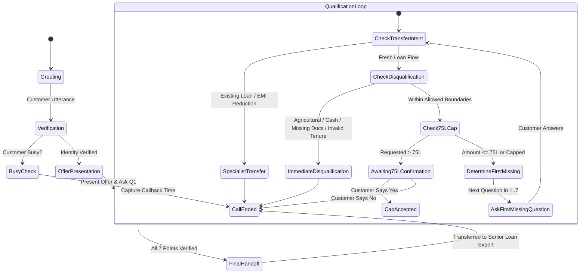

# Architecture & System Design — Home Credit LAP AI Voice Agent

## 1. Executive Summary
The **Home Credit Loan Against Property (LAP) AI Voice Agent** is engineered as a robust, production-grade conversational system designed to qualify existing customers for high-value secured lending. Rather than delegating critical credit decisions to stochastic Large Language Model (LLM) generation, the system decouples conversational interpretation from deterministic business rule enforcement.

The architecture strictly follows the paradigm:
$$\text{Voice Input} \rightarrow \text{Fact Extraction} \rightarrow \text{State Management} \rightarrow \text{Deterministic Rule Engine} \rightarrow \text{Decision} \rightarrow \text{Next Response / Handoff}$$

---

## 2. High-Level Architecture Diagram

```mermaid
graph TD
    User([Customer Voice / Audio Stream]) -->|Audio| STT[Voice Layer / STT Provider<br>Browser Web Speech / Retell / Bolna]
    STT -->|Raw Utterance| Extractor[Fact Extraction & Normalization Engine<br>src/engine/extractor.py]
    
    subgraph "Core Cognitive Engine"
        Extractor -->|Extracted Facts + Corrections| StateMgr[State Manager & Session Store<br>src/engine/models.py]
        StateMgr -->|Updated State| RuleEngine[Deterministic Business Rule Engine<br>src/engine/rules.py]
        RuleEngine -->|Eligibility & Boundary Evaluation| Orchestrator[Conversation Orchestrator<br>src/engine/orchestrator.py]
        RAG[(RAG Product Knowledge<br>{{additional_context_from_rag}})] -.->|Factual Context| Orchestrator
    end

    subgraph "Decision & Branching Gates"
        Orchestrator -->|Disqualification Detected| DisqBranch[Immediate Disqualification Gate<br>Polite Explanation + End Call]
        Orchestrator -->|Existing Loan / EMI Transfer| TransBranch[Loan Transfer Specialist Switch<br>Specialist Handoff + End Call]
        Orchestrator -->|Loan > 75L| CapBranch[75L Capping Offer Gate<br>Offer Max 75L & Await Yes/No]
        Orchestrator -->|Incomplete Qualification| NextQBranch[First-Missing Question Selector<br>Strict Sequence 1 -> 7]
        Orchestrator -->|All 7 Answered & Valid| HandoffBranch[Final Handoff Gate<br>Transfer to Senior Loan Expert]
    end

    DisqBranch --> TTS[Speech Synthesis / Audio Output<br>Web Speech / gTTS / Retell Telephony]
    TransBranch --> TTS
    CapBranch --> TTS
    NextQBranch --> TTS
    HandoffBranch --> TTS
    TTS --> Output([Customer Speaker / Audio Stream])
```

---

## 3. Component Breakdown

### 3.1 Voice & Telephony Layer (`src/providers/`)
The system abstracts voice providers to achieve complete infrastructure independence:
- **`VoiceProvider` (`src/providers/base.py`)**: Abstract base class defining speech synthesis, transcription, and telemetry.
- **`RetellAIProvider` (`src/providers/retell.py`)**: Native adapter for Retell AI's Custom LLM WebSocket protocol and webhooks (`call_started`, `call_ended`).
- **`BolnaProvider` (`src/providers/bolna.py`)**: Webhook integration for Bolna voice workflows.
- **`LocalTTSProvider` (`src/providers/local_tts.py`)**: Offline/local fallback using `gTTS` and `SpeechRecognition` to ensure fully autonomous execution without paid third-party dependencies.
- **Browser Web Speech Engine (`public/app.js`)**: Real-time in-browser microphone recognition (`webkitSpeechRecognition`) and speech synthesis (`window.speechSynthesis`) for instantaneous zero-latency local evaluations.

### 3.2 Fact Extraction & Normalization Engine (`src/engine/extractor.py`)
- **Multi-Fact Parsing**: Extracts all relevant facts when a customer provides multiple data points in a single sentence (e.g., *"It's a residential house, jointly owned with my wife, and worth around 80 lakhs"*).
- **Indian Financial Numeral Normalization**:
  - Lakhs: `50 lakh`, `50L`, `₹50,00,000`, `fifty lakhs` $\rightarrow$ `5,000,000`
  - Crores: `1 crore`, `1 cr`, `1.5 crore`, `one crore` $\rightarrow$ `10,000,000` / `15,000,000`
- **Conversational Corrections Detection**:
  - Automatically identifies revision clauses (`"... actually make that 15"`, `"... instead of that, agricultural"`, `"Bank... actually cash"`).
  - Overwrites previous intents with the customer's explicitly corrected value.
- **Contextual Disambiguation**: Differentiates between property market valuation (`worth 80 lakhs`) and loan borrowing demand (`need 40 lakhs`).

### 3.3 Strongly Typed State Model (`src/engine/models.py`)
State is maintained via Pydantic v2 data models:
```python
class QualificationState(BaseModel):
    customer_verified: Optional[bool] = None
    customer_busy: Optional[bool] = None
    callback_time: Optional[str] = None

    # 7 Core Eligibility Data Points
    property_type: Optional[str] = None          # residential, commercial, industrial, agricultural
    ownership_status: Optional[str] = None       # sole, joint
    documents_available: Optional[str] = None    # original, photocopy, missing
    loan_amount: Optional[int] = None            # <= 75,00,000
    original_requested_loan_amount: Optional[int] = None
    occupation: Optional[str] = None             # salaried, self-employed
    income_mode: Optional[str] = None            # bank, cash
    market_value: Optional[int] = None           # estimate in INR
    tenure_years: Optional[int] = None           # 3 to 15 years

    # Existing loan / transfer flags
    existing_property_loan: Optional[bool] = None
    emi_reduction_request: Optional[bool] = None
    transfer_required: bool = False
    transfer_reason: Optional[str] = None

    # Disqualification and gating
    disqualified: bool = False
    disqualification_reason: Optional[str] = None
    awaiting_75l_confirmation: bool = False
    current_checklist_item: Optional[str] = None
    handoff_required: bool = False
    call_ended: bool = False
    call_stage: CallStage = CallStage.GREETING
```

### 3.4 Deterministic Business Rule Engine (`src/engine/rules.py`)
Separates lending risk evaluation from LLM token sampling:
1. `evaluate_property_type()`: Residential, Commercial, Industrial are approved; Agricultural immediately triggers rejection.
2. `evaluate_ownership()`: Sole and Joint ownership are both accepted.
3. `evaluate_documents()`: Original documents physical availability is mandatory; photocopies/missing documents trigger rejection.
4. `evaluate_loan_amount()`: Amounts $\le ₹75\text{ Lakh}$ proceed; amounts $> ₹75\text{ Lakh}$ trigger capping verification.
5. `evaluate_occupation()`: Salaried and Self-employed are approved.
6. `evaluate_income_mode()`: Bank credits are approved; cash income triggers rejection.
7. `evaluate_market_value()`: Freeform estimated value captured without arbitrary minimum floor constraints.
8. `evaluate_tenure()`: Inclusive range $[3, 15]$ years allowed; $<3$ or $>15$ triggers rejection.
9. `evaluate_transfer_condition()`: Existing property loan or EMI reduction shifts caller to loan-transfer specialist.
10. `evaluate_overall_eligibility()`: Handoff Gate strictly requiring all 7 checklist items fulfilled before Senior Loan Expert handoff.

---

## 4. Conversation Lifecycle State Machine



---

## 5. Security, Privacy, and Environment Hygiene
- **Zero Hardcoded Secrets**: All tokens (`RETELL_API_KEY`, `BOLNA_API_KEY`, `OPENAI_API_KEY`) are dynamically resolved from system environment variables.
- **Git Hygiene**: `.env` and local sensitive caches are strictly ignored via `.gitignore`.
- **Clean Configuration**: Standard `.env.example` provides explicit template variables for frictionless deployment.
